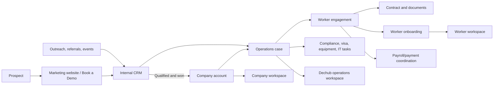
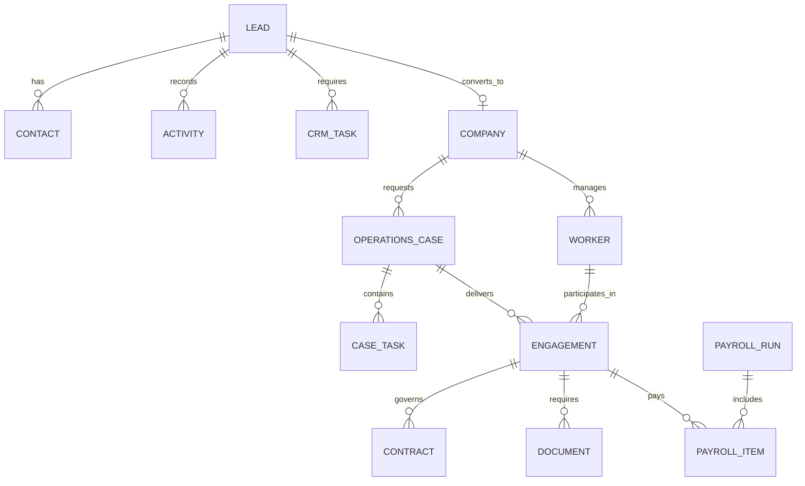

# System Architecture

## 1. Architecture principle

The CRM is the commercial source of truth. The Operations Case is the delivery source of truth. The client workspace is not the CRM.

## 2. Application components

| Component | Current state | Target responsibility |
| --- | --- | --- |
| Public website | Exists | Marketing, service explanation, lead capture, newsletter signup. |
| Client application | Exists | Company onboarding and company workforce workspace. |
| Worker application | Exists | Worker onboarding, contract, documents, invoices, and delivery tasks. |
| Admin application | Partial | Internal lead CRM, case operations, review queues, and reporting. |
| Node/Express API | Exists | Authentication, business rules, data access, integrations, webhooks. |
| MongoDB | Exists | Operational application database. |
| Document storage | Local disk today | Private object storage with signed URLs in production. |
| Email provider | Resend/SMTP exists | Transactional email and CRM message delivery. |
| Messaging provider | Missing | Official WhatsApp Cloud API after consent and templates. |
| E-signature provider | Partial DocuSign service | Verified document templates, signature flow, and signed-event webhooks. |
| Payments | Stripe setup only | Invoice collection or payment coordination, then country-specific payout partners. |

## 3. Core data model

### Required new collections

- `Lead`, `Contact`, `Activity`, `CrmTask`, and `Deal`.
- `OperationsCase`, `CaseTask`, and `CaseDocumentRequirement`.
- `Engagement` separate from `Worker`; one worker may have many engagements.
- `Document` and `DocumentVersion` separate from file paths inside other models.
- `PayrollRun`, `PayrollItem`, `PaymentBatch`, and `Payout` when payroll operations are introduced.
- `MobilityCase`, `EquipmentRequest`, and `AccessRequest` as P1/P2 modules.
- `AuditEvent` for important business and security actions.

## 4. API boundaries

| API area | Consumers | Responsibility |
| --- | --- | --- |
| `/api/public` | Website | Newsletter and safe public forms. |
| `/api/crm` | Internal Admin | Leads, contacts, tasks, activities, deals, templates. |
| `/api/cases` | Internal Admin and Company | Operations cases, checklists, tasks, requests. |
| `/api/company` | Company Admin | Company profile, workspace, company-level records. |
| `/api/workers` | Company Admin | Managed worker access and invitations. |
| `/api/contractor` | Worker | Personal onboarding and worker actions. |
| `/api/contracts` | Company Admin | Contract review and countersignature. |
| `/api/payroll` | Admin and Company | Payroll coordination; add only when real workflow exists. |
| `/api/webhooks/*` | Providers | Signature, payment, and WhatsApp webhook processing. |

## 5. Security baseline

- Store uploads in private object storage, not public server folders.
- Issue short-lived signed URLs after authorization.
- Verify webhook signatures from DocuSign, Stripe, and Meta.
- Separate provider credentials from application data through environment variables or a secret manager.
- Add request logs, audit events, rate limits, monitoring, backup/restore checks, and error tracking.
- Never expose a worker's KYC, bank, or identity information to another company.

## 6. Integration sequence

1. Email and internal notifications.
2. CRM email timeline and calendars.
3. Private file storage.
4. E-signature with validated webhook delivery.
5. CRM WhatsApp with consent, approved templates, and message logging.
6. Payment collection and payout partners only after operational readiness.
