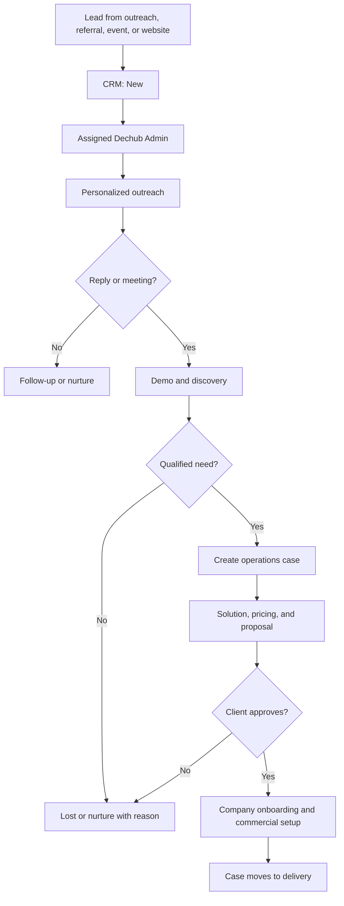
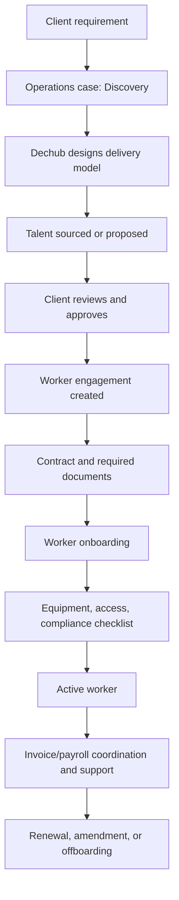
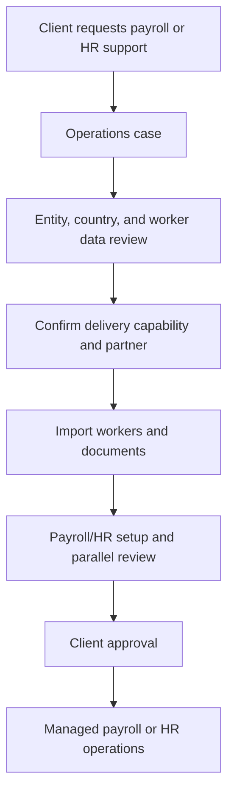

# Operating Flows

## 1. Lead to active client

## 2. Managed workforce flow - V1

## 3. Existing-workforce operations flow - later

Do not build this path until leadership confirms that Dechub-Bridge will operate payroll for workers not sourced by Dechub.

## 4. CRM communication flow

1. A lead enters through a website form, manual entry, import, referral, or outreach list.
2. The system records source, owner, company, contact, consent, and initial context.
3. The owner sends a short personalized message, not a product brochure.
4. All sent messages, replies, calls, tasks, demo dates, notes, and next steps appear in the lead timeline.
5. Once discovery confirms an actual need, the lead becomes qualified.
6. A qualified lead creates a company and operations case; the CRM history remains connected.
7. Won leads become active client accounts. Lost/nurture leads remain available for compliant future follow-up.

## 5. Worker onboarding flow

1. Dechub Admin or Company Admin creates an engagement and invites the worker.
2. Worker verifies identity, completes personal data, adds payment details, and supplies required documents.
3. Dechub reviews requirements and marks checklist items complete or blocked.
4. Worker signs the contract; Company Admin countersigns where required.
5. The engagement becomes active only after required approvals are complete.
6. The client and worker see only information appropriate to their role.

## 6. Payroll coordination flow

1. Admin creates a payroll period for a company/country.
2. Eligible active engagements enter the draft run.
3. Admin adds approved pay components, invoices, reimbursements, and adjustments.
4. Client reviews and approves the run.
5. Dechub coordinates payment using a supported provider or records manual payment status.
6. System stores payout reference, payslip/document, and reconciliation status.

This is the target flow. The current application does not yet execute it.

## 7. Visa, equipment, and access flow

1. A service case or worker engagement requests mobility, equipment, or system access.
2. Dechub Admin creates required checklist items, assigns an internal owner or partner, and collects documents.
3. Progress, approvals, dispatch/reference numbers, expiry dates, and blockers are visible in the case.
4. On offboarding, access is revoked and equipment return is tracked.
